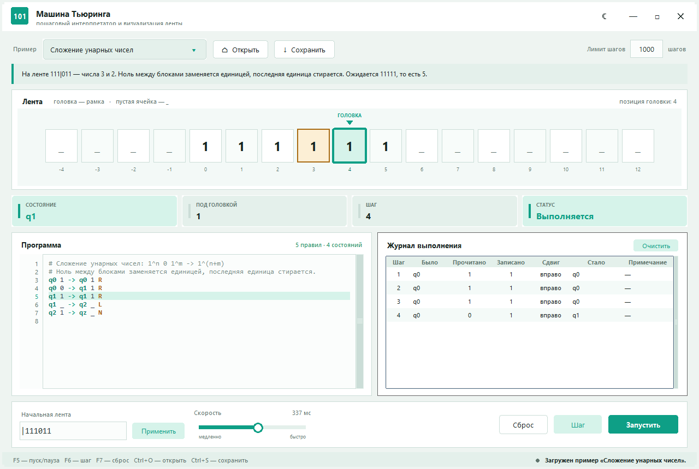

# Машина Тьюринга

Интерпретатор машины Тьюринга с графическим интерфейсом. Программа показывает
работу машины по шагам: головка двигается по ленте, символы меняются, состояние
переключается, а журнал сохраняет каждый переход.

Курсовая работа по дисциплине «Теория алгоритмов».  
Автор: Дутикова Ксения Дмитриевна, группа Б.ПИН.РИС-24.06.



## Быстрый старт

Для запуска нужен только Python 3.10 или новее. Сторонние библиотеки не
требуются.

```bash
python main.py
```

Если Python не добавлен в PATH, на Windows можно запустить так:

```bash
py main.py
```

## Что умеет программа

- редактор таблицы переходов с проверкой синтаксиса и номером строки;
- редактор начальной ленты, маркер `|` задаёт положение головки;
- пошаговое выполнение и автоматический запуск с регулируемой скоростью;
- пауза и сброс к начальному состоянию;
- лента с номерами позиций, подсветкой головки и плавным движением;
- индикаторы состояния, символа под головкой, номера шага и статуса;
- журнал с прочитанным и записанным символом, сдвигом и новым состоянием;
- лимит шагов для защиты от зацикливания;
- сохранение и открытие программы в текстовом файле;
- пять готовых примеров с описанием ожидаемого результата;
- светлая и тёмная темы.

## Формат программы

Одна строка — одно правило. Комментарии начинаются с `#`, пустые строки
пропускаются. Стрелку можно писать как `->` или `→`, регистр не важен.

```text
# Сложение унарных чисел: 1^n 0 1^m -> 1^(n+m)
q0 1 -> q0 1 R
q0 0 -> q1 1 R
q1 1 -> q1 1 R
q1 _ -> q2 _ L
q2 1 -> qz _ N
```

Поля правила: текущее состояние, прочитанный символ, новое состояние,
записываемый символ и сдвиг (`L` — влево, `R` — вправо, `N` — на месте).
Состояния `qz`, `qz_*` и `q!` считаются состояниями останова.

Начальная лента задаётся строкой, например `|111011`. Маркер `|` показывает,
где стоит головка; без маркера она ставится в нулевую позицию. Пустая ячейка
обозначается подчёркиванием `_`.

## Готовые примеры

| Пример | Вход | Результат | Шагов |
|---|---|---|---|
| Сложение унарных чисел | `111011` | `11111`, qz | 8 |
| Копирование унарного числа | `111` | `1110111`, qz | 49 |
| Сравнение двух чисел | `111011` | `qz_greater` | 29 |
| Сравнение двух чисел | `110111` | `qz_less` | 25 |
| Сравнение двух чисел | `1110111` | `qz_equal` | 45 |
| Стирание ленты | `111011` | пустая лента, qz | 7 |
| Зацикленная программа | `1` | лимит 60 шагов | 60 |

## Горячие клавиши

| Клавиши | Действие |
|---|---|
| `F5` | пуск / пауза |
| `F6` | один шаг |
| `F7` | сброс |
| `Ctrl+O` | открыть программу |
| `Ctrl+S` | сохранить программу |

## Структура проекта

```text
KursAlg/
├── main.py              точка входа
├── turing/              ядро: лента, программа, исполнитель
│   ├── errors.py        исключения
│   ├── tape.py          лента и головка
│   ├── program.py       правила и разбор таблицы переходов
│   ├── machine.py       исполнитель и журнал шагов
│   └── examples.py      готовые примеры
├── ui/                  интерфейс на Tkinter
│   ├── app.py           главное окно
│   ├── tape_view.py     анимированная лента
│   ├── editor.py        редактор с подсветкой
│   ├── widgets.py       свои кнопки и ползунок
│   ├── chrome.py        рамка окна
│   └── theme.py         светлая и тёмная палитры
├── tests/               тесты pytest
├── tools/               скриншоты и диаграммы
├── docs/
│   ├── diagrams/        схема ленты, блок-схема, диаграмма классов
│   └── screenshots/     экранные формы
├── report/              пояснительная записка, презентация, доклад
├── pytest.ini
├── requirements.txt
└── README.md
```

Ядро не импортирует Tkinter, поэтому тесты запускаются без окна. Интерфейс
обращается только к публичным классам `Tape`, `Program` и `Machine`.

## Тесты

```bash
python -m pytest
```

Сейчас проходят 92 теста. Покрытие пакета `turing` — 96 %.

Для проверки покрытия:

```bash
python -m coverage run -m pytest
python -m coverage report -m turing/*.py
```

`pytest`, `coverage` и `Pillow` нужны только для тестов и подготовки скриншотов.
В рантайме используется стандартная библиотека.

## Документы

- `report/Курсовая_работа_ДутиковаКД.docx` — пояснительная записка;
- `report/Презентация_ДутиковаКД.pptx` — презентация к защите;
- `report/Доклад_ДутиковаКД.docx` — доклад на 5–6 минут.

Пояснительная записка содержит введение, три главы, заключение, список
источников и два приложения. Приложение А повторяет код из репозитория,
приложение Б — актуальные экранные формы.

## Лицензия

Учебный проект. Код можно использовать для изучения машины Тьюринга и
построения собственных интерпретаторов.
